# KLeanScreen

A small, fast touchscreen UI for Klipper printers with a **Bondtech INDX** tool
changer. It replaces KlipperScreen with only the screens you need at the printer:
load, unload and purge per tool, pick a file and print, babystep the first
layer, pause, cancel, and the emergency stop.

<p align="center">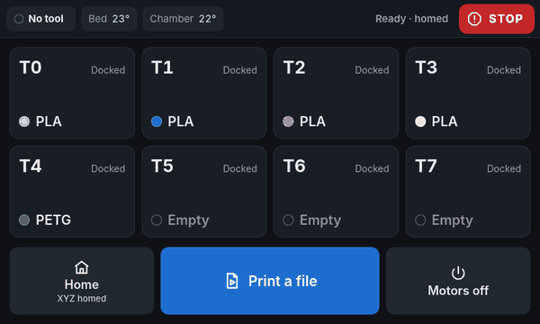</p>

**Try it in your browser:** [live demo](https://stephenwilley.github.io/KLeanScreen/web/?demo)
(a pretend printer runs in the page; nothing is sent anywhere). Add
`&tools=4` or `&tools=12` to the address to see other tool counts.

- **Built for a tool changer.** One tile per tool showing what's loaded, its
  colour and which tool is on the head. Tap a tile to load, unload, purge or
  set its colour.
- **Flows stay in Klipper.** Load, purge and unload are macros using Mainsail's
  `action:prompt` dialogs. The screen draws any macro prompt, so Mainsail, Fluidd
  and the screen always offer the same choices.
- **First-layer babystepping**, with an offer to save the new Z offset when the
  print ends.
- **Checks before printing.** The file page lists which tools the file uses and
  warns when a tool has a different material loaded.
- **Light.** No framework and no build step: plain HTML, CSS and JS in a WebKit
  kiosk on the [cage](https://github.com/cage-kiosk/cage) Wayland compositor,
  straight on KMS. No X server.
- **Screen blanking that keeps touch working**, with a dim status line during
  prints so a glance still tells you how far along it is.

> Tested on a Voron Trident running Kalico with an 8-tool INDX, an Orange Pi
> CM4 (RK3566, Ubuntu 24.04) and a BTT HDMI5 (800×480). It should work on any
> Debian-family host with an 800×480 touchscreen; reports from Raspberry Pi
> users are welcome.

## Screens

| | | |
|---|---|---|
| 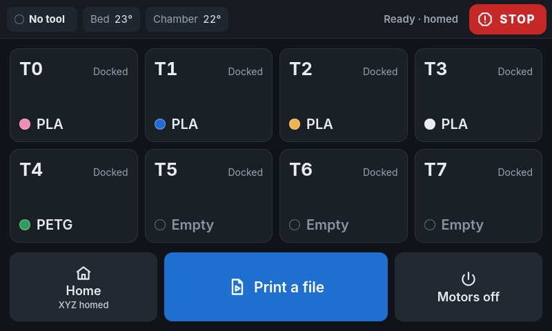 | 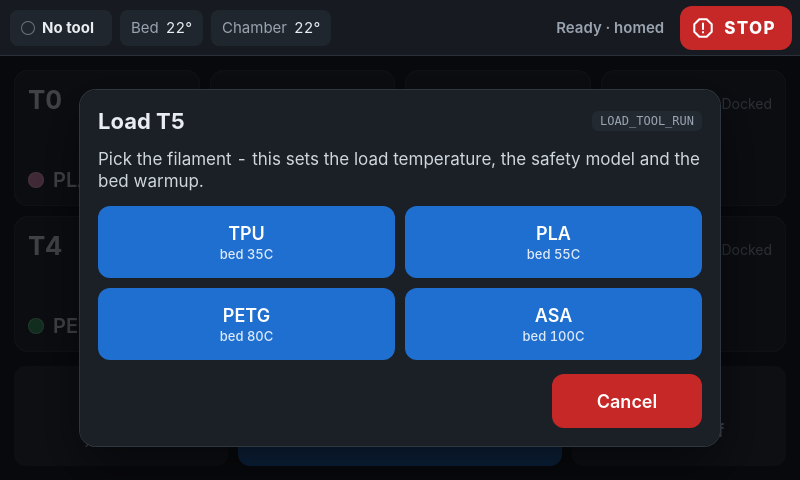 | 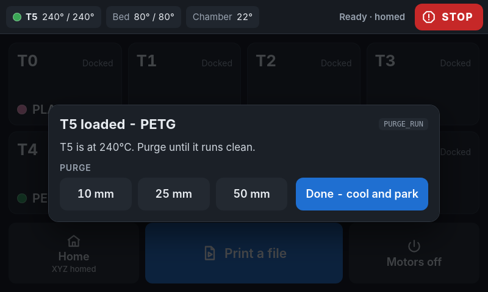 |
| Home: one tile per tool | Load: a macro prompt | Purge until it runs clean |
| 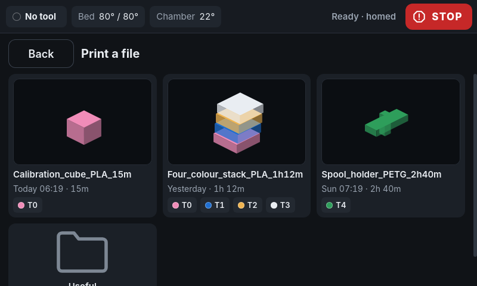 | 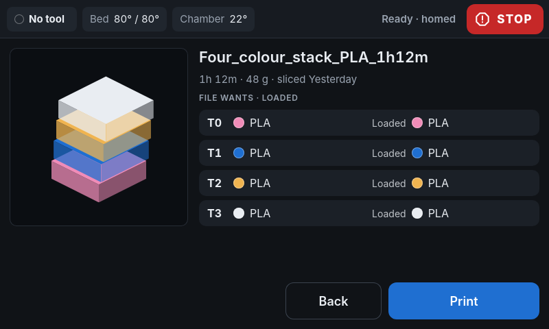 | 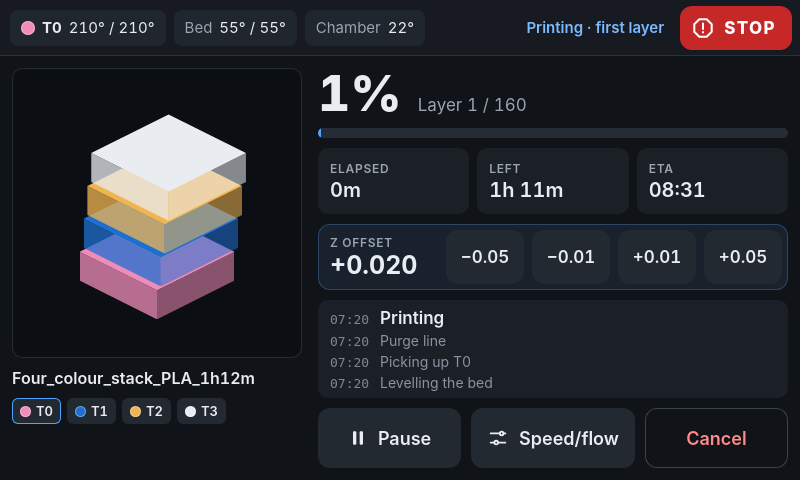 |
| Files, with folders | What the file needs vs. what's loaded | First layer: Z offset buttons |
| 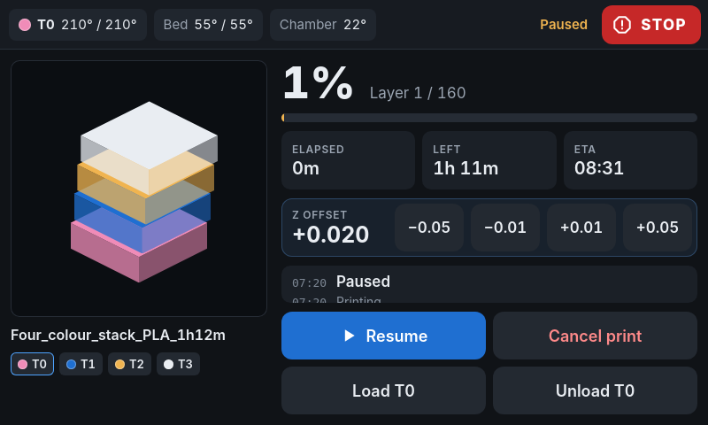 | 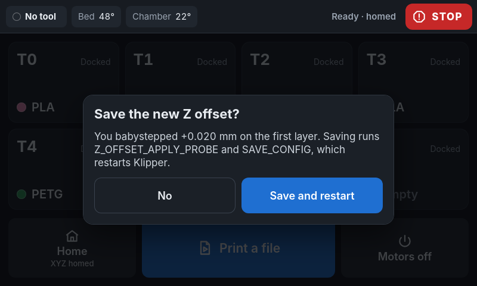 | 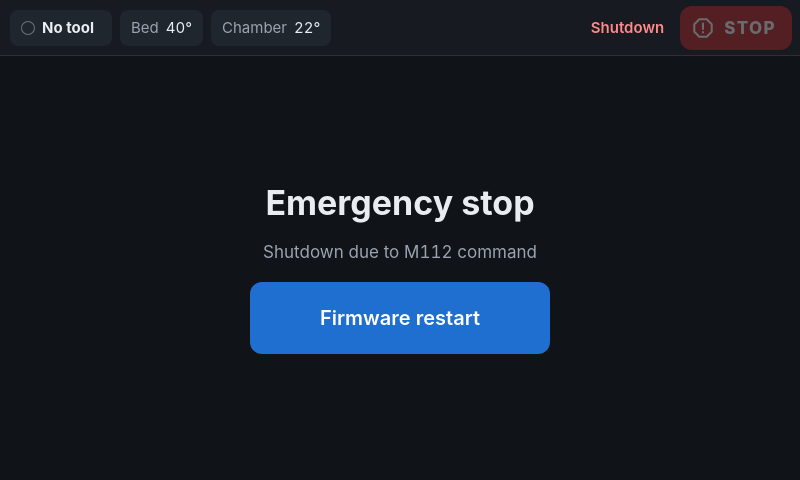 |
| Paused: load or unload the tool on the head | Keep the babystep? | Shutdown and firmware restart |

## Requirements

- Klipper or Kalico, with Moonraker.
- The [INDX macro package](https://github.com/BondtechAB/INDX), set up and
  calibrated. KLeanScreen reads `TOOL_POSITIONS.tool_count` and uses
  `CHANGE_TOOL`, `PARK_TOOL` and `LOAD_FILAMENT`.
- `[save_variables]`, `[respond]` and `[pause_resume]` in your config (Mainsail's
  and Fluidd's standard configs include the last two).
- An 800×480 touchscreen on HDMI or DSI that works under KMS. Other sizes will
  run, but the layout is drawn for 800×480.
- A Debian-family OS with these packages: `cage`, `gir1.2-webkit2-4.1`,
  `python3-gi`, `python3-gi-cairo` and `fonts-inter`. That's about 190 MB with
  dependencies, using `--no-install-recommends`.

## Install

The commands assume the repository lives at `~/KLeanScreen`.

### 1. Packages and the code

```sh
sudo apt install --no-install-recommends cage gir1.2-webkit2-4.1 python3-gi python3-gi-cairo fonts-inter
cd ~ && git clone https://github.com/stephenwilley/KLeanScreen.git
```

### 2. Klipper macros

`klipper/kleanscreen.cfg` holds the macros the screen calls:
- `LOAD_TOOL`, `UNLOAD_TOOL` and `PURGE_TOOL`, which use the prompt dialogs;
- `UNLOAD_FILAMENT`, a ram, cool and pull unload;
- the per-tool material and colour records;
- `SCREEN_SLEEP` and `SCREEN_WAKE`.

```sh
ln -s ~/KLeanScreen/klipper/kleanscreen.cfg ~/printer_data/config/kleanscreen.cfg
```

Then add this to `printer.cfg`, **after** the INDX includes, and restart Klipper:

```ini
[include kleanscreen.cfg]
```

If you already have your own `UNLOAD_FILAMENT`, delete that section from the
file. Klipper keeps whichever definition it reads last.

### 3. Check the display

Stop whatever is on the screen now, such as KlipperScreen or a desktop session,
then check the panel has a mode under KMS:

```sh
sudo systemctl disable --now KlipperScreen    # if you have it
cat /sys/class/drm/card*-*/modes              # expect a line like 800x480
```

If nothing is listed, the panel needs help first. For the BTT HDMI5 on an RK3566
board, see [the note at the end](#btt-hdmi5-on-rk3566-orange-pi-cm4-and-similar).

### 4. The service

```sh
cd ~/KLeanScreen
sed -e "s|@USER@|$USER|g" -e "s|@HOME@|$HOME|g" system/KLeanScreen.service \
  | sudo tee /etc/systemd/system/KLeanScreen.service >/dev/null
sudo systemctl daemon-reload
sudo systemctl enable --now KLeanScreen
```

The screen should come up within a few seconds. Its log is
`~/printer_data/logs/kleanscreen.log`.

### 5. Moonraker (optional)

Add this to `moonraker.conf` so Mainsail and Fluidd can update KLeanScreen:

```ini
[update_manager KLeanScreen]
type: git_repo
path: ~/KLeanScreen
origin: https://github.com/stephenwilley/KLeanScreen.git
primary_branch: main
managed_services: KLeanScreen
```

To let them restart it too, run this, then restart Moonraker:

```sh
echo KLeanScreen >> ~/printer_data/moonraker.asvc
```

## Using it

- **Tool tiles:** tap a tile for Load, Unload, Purge and Set colour.
  - **Load:** asks for the material, then the colour (you can skip it). It heats
    and loads while you pick, then shows the purge prompt. **Done** cools the
    tool and parks it.
  - **Purge:** picks up a loaded tool, heats it to its material's temperature,
    and purges in 10, 25 or 50 mm steps.
- **Print a file:** opens the file browser. The confirm page lists the tools
  the file uses next to what's loaded in them, and highlights any mismatch.
- **While printing:** the Z offset row appears on layer 1. If the Z offset
  changed, you're asked whether to keep it when the print finishes or is
  cancelled.
  - **Save and restart** runs `Z_OFFSET_APPLY_PROBE` and `SAVE_CONFIG`, which
    restarts Klipper.
  - **Pause** and **Cancel** both ask first, so a stray tap doesn't stop
    the print.
  - **While paused**, Load and Unload work on the tool on the head, for a
    filament change mid-print.
- **STOP** is always in the top right. It sends an emergency stop straight
  away, with no confirmation. **Firmware restart** brings the printer back.
- **Errors** from Klipper appear in a card until you dismiss them. Klipper
  repeats one failure several times as a macro unwinds; the card shows it once.

### Screen blanking

The screen goes black after 15 minutes without a tap. The HDMI output and touch
stay on, because many panels' backlights ignore the signal and glow grey when
it stops.
- **Waking it:** the first tap only wakes the screen, so a tap on a black screen
  can't press anything. It also wakes for a macro prompt, a pause, an error, and
  `SCREEN_WAKE`.
- **During a print:** a dim line with progress, layer and ETA moves to a new spot
  every minute.
- **From G-code:** `SCREEN_SLEEP` blanks it, for example at the end of
  `PRINT_END`.

## Configuration

Settings are passed in the page address through `KLEAN_QUERY`. Set it in a
systemd drop-in:

```sh
sudo systemctl edit KLeanScreen
```
```ini
[Service]
Environment=KLEAN_QUERY=?blank=300
```

| Setting | Default | |
|---|---|---|
| `blank=<seconds>` | `900` | Idle time before the screen blanks. `0` turns blanking off. |
| `moonraker=<host:port>` | `127.0.0.1:7125` | The Moonraker to talk to. |

**Materials:** the Load prompt's buttons are in `_LOAD_TOOL_MATERIAL`, and the
bed warm-up temperatures are in `_LOAD_TOOL_RUN`, both in `kleanscreen.cfg`. The
hotend temperatures come from INDX's `LOAD_FILAMENT` `filament_presets`. Any
material you add there can be added as a button.

### Number of tools

The tool count comes from INDX's `variable_tool_count` in `TOOL_POSITIONS`,
which you set when configuring INDX. Nothing in KLeanScreen needs changing: the
macros loop over that count, and the per-tool records size themselves to it.
- **Layout:** up to 4 tools sit in one row, up to 12 in two rows, then three
  rows.
- **Narrow tiles:** from 6 columns the tiles drop their Docked/On head label to
  fit. The tool on the head keeps its highlight.

| 4 tools | 12 tools |
|---|---|
| 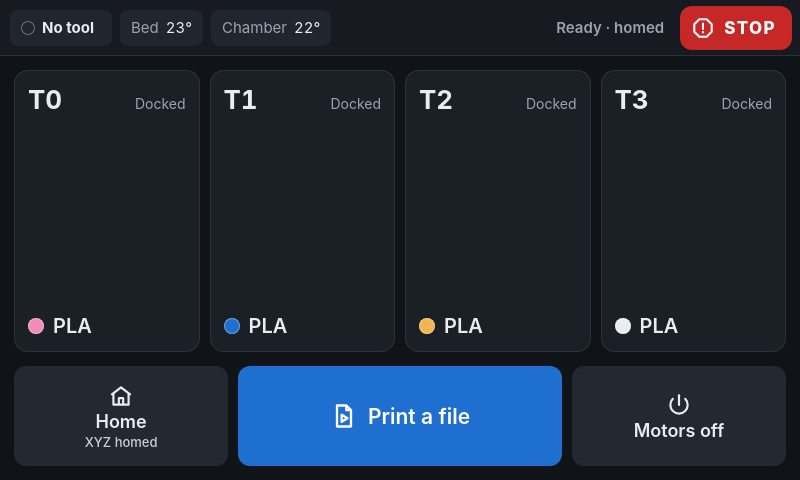 | 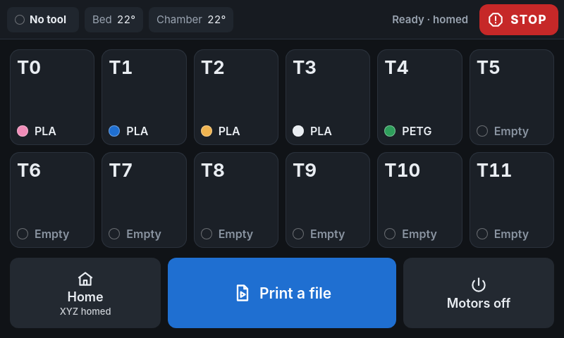 |

## How it works

```
systemd: KLeanScreen.service (a logind seat session on tty7)
  └ scripts/kleanscreen-start.sh
      └ cage             Wayland kiosk compositor, straight on KMS/DRM
          └ kiosk/kiosk.py    WebKitGTK, fullscreen; serves web/ on 127.0.0.1:7136
              └ web/          app.js, moonraker.js, prompt.js, style.css
                  └ ws://127.0.0.1:7125/websocket   Moonraker
```

- **Served over HTTP:** the page comes from a local HTTP server, not `file://`,
  because Moonraker refuses websockets from `Origin: null`.
- **Redraws:** status updates arrive every 250 ms. The screen redraws at most
  twice a second for them, and only touches the page when something visible
  changed.
- **Clock:** times use the system's UTC offset, which the kiosk serves at
  `/tz`, because WebKit's built-in time zone rules can be older than the OS's.

Resource use on an RK3566 (four Cortex-A55 cores):

| | CPU (share of one core) | Memory |
|---|---|---|
| X + KlipperScreen, idle | 1.2% | ~86 MB |
| KLeanScreen, idle | 2.0% | ~220 MB |
| KLeanScreen, printing screen | ~13% | |

### The macro protocol

KLeanScreen needs nothing special from Klipper. It reads printer objects through
Moonraker, and it shows the standard `// action:prompt_*` dialogs that
`RESPOND TYPE=command` sends. The `save_variables` it uses:

| Variable | Written by | Meaning |
|---|---|---|
| `active_tool` | INDX | Tool on the head, `-1` for none |
| `tool_materials` | `LOAD_TOOL`, `UNLOAD_FILAMENT` | List by tool: `"PLA"`, or `""` for empty |
| `tool_colours` | the screen | List by tool: hex without `#` (Klipper ends a G-code line at `#`) |

`RESPOND TYPE=command MSG="kleanscreen:sleep"` and `kleanscreen:wake` blank and
wake the screen. `SCREEN_SLEEP` and `SCREEN_WAKE` send them for you.

## Development

The UI is plain ES modules in `web/`, with no build step. To work on it without
a printer:

```sh
python3 -m http.server -d web 8000
# open http://localhost:8000/?demo
```

`web/demo.js` is a pretend Moonraker that acts out the macros. To try the real
screen against a printer from a laptop, open
`http://localhost:8000/?moonraker=<printer>:7125`. Your laptop's address has to
be in Moonraker's `cors_domains` for that to work.

On the printer, two signals help over SSH. Both write to
`$XDG_RUNTIME_DIR/kleanscreen/`:
- **Screenshot:** `kill -USR2 $(cat $XDG_RUNTIME_DIR/kleanscreen/kiosk.pid)`
  saves `shot.png`.
- **Run JavaScript, then screenshot:** `-USR1` runs `cmd.js` from that folder in
  the page first. `window.KLEAN` gives access to the app's state.

## Uninstall

```sh
sudo systemctl disable --now KLeanScreen
sudo rm -rf /etc/systemd/system/KLeanScreen.service*
sudo systemctl daemon-reload
```

Then remove the `[include kleanscreen.cfg]` line, the `[update_manager KLeanScreen]`
section, and the `KLeanScreen` line in `~/printer_data/moonraker.asvc`.

If you installed the RK3566 extras:

```sh
sudo systemctl disable --now kleanscreen-edid hdmi-clock-fix
sudo rm -f /etc/systemd/system/kleanscreen-edid.service /etc/systemd/system/hdmi-clock-fix.service \
  /usr/local/sbin/kleanscreen-edid-load /usr/local/sbin/hdmi-clock-fix-load \
  /lib/modules/$(uname -r)/extra/hdmi_clock_fix.ko
sudo rm -rf /usr/local/share/kleanscreen
sudo depmod && sudo systemctl daemon-reload
```

## License

MIT, see [LICENSE](LICENSE). The one exception is the kernel module in
`extras/hdmi-clock-fix`, which is GPL-2.0 like the kernel it loads into.

## BTT HDMI5 on RK3566 (Orange Pi CM4 and similar)

This panel's EDID offers only one timing, 800×480 at a 25 MHz pixel clock. The
RK3566 can't produce that, so the kernel drops the mode and the connector has
no modes at all. Under X a custom modeline got around it; under KMS the EDID
has to change. `edid/btt-hdmi5.bin` is the panel's EDID with that timing
replaced by one at 37.125 MHz, made by `edid/make-edid.py`.

Many kernels for these boards are built without
`CONFIG_DRM_LOAD_EDID_FIRMWARE`, so `drm.edid_firmware=` doesn't work.
`kleanscreen-edid.service` writes the EDID through debugfs at every boot
instead:

```sh
cd ~/KLeanScreen
sudo install -D -m 644 edid/btt-hdmi5.bin /usr/local/share/kleanscreen/btt-hdmi5.bin
sudo install -m 755 system/kleanscreen-edid-load /usr/local/sbin/
sudo install -m 644 system/kleanscreen-edid.service /etc/systemd/system/
sudo install -D -m 644 system/KLeanScreen.service.d/10-btt-hdmi5-rk3566.conf \
  /etc/systemd/system/KLeanScreen.service.d/10-btt-hdmi5-rk3566.conf
sudo systemctl daemon-reload && sudo systemctl enable --now kleanscreen-edid
```

The drop-in also requires `hdmi-clock-fix.service`. It loads a small kernel
module that sets the RK3566's HDMI reference clock to 37.125 MHz, which some
vendor kernels leave at 24 MHz. Its source, loader and unit are in
[`extras/hdmi-clock-fix`](extras/hdmi-clock-fix), with build steps. If your
board shows 800x480 in `modes` without it, delete that service from the drop-in.
